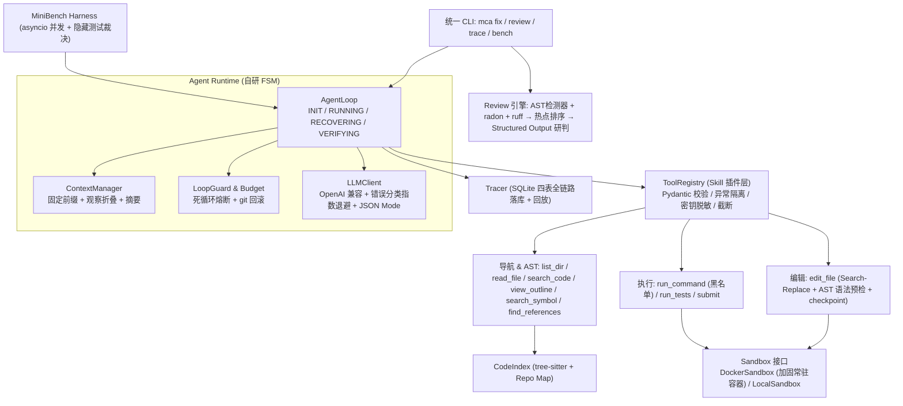

# MiniCodeAgent (`mca`)

> 一个从零手写、**不依赖 LangChain 等黑盒框架**的轻量级代码 Agent 运行时与评测 Harness。
> 支持 **Fix（自主定位与修复 Bug）** 与 **Review（遗留“屎山代码”静态诊断 + 测试护航安全重构）** 两种工作模式。

## 为什么做这个项目

相比“调包套壳 + 简单 RAG”，本项目聚焦于真实 Coding Agent 工程落地的核心难题：
- **可控的多轮状态机**：显式 FSM（`INIT → RUNNING → RECOVERING / VERIFYING → DONE / FAILED`），`submit` 不等于结束，必须经确定性测试裁决；
- **模型与确定性代码的边界**：AST 语法预检、唯一性 Search-Replace、禁改测试防 Reward Hacking、4 条确定性 LoopGuard 死循环熔断与 `git` 自动回滚；
- **结构化代码检索与上下文压缩**：`tree-sitter` 容错 AST 索引 + 按引用热度排序的 Repo Map + 观察折叠（区分高信号工具防上下文失忆）+ 工作记忆摘要；
- **纵深安全沙箱**：加固 `DockerSandbox`（断网 / cgroups / 非 root / 去特权 / 只读根文件系统）+ 敏感文件隔离与输出密钥脱敏；
- **全链路可观测性与评测 Harness**：SQLite 四表 Trace（支持时间线回放与 SQL 统计）+ 自建带隐藏测试的 `MiniBench` 并发消融实验框架。

---

## 系统架构



---

## 核心实测数据

### 1. MiniBench 消融实验（E1：开启 AST 检索 & Repo Map vs 关闭）

测试模型：`deepseek-v4.1-flash`｜6 道多类别 Python 任务（含隐藏测试防作弊）｜`asyncio` 并发运行｜详见 `bench/results/`

| 配置 | 隐藏测试通过率 | 正式验收通过率 (`verified`) | 平均步数 | 平均总 Token | 平均耗时 | 触发恢复次数 |
|---|---:|---:|---:|---:|---:|---:|
| **`full`（AST + Repo Map 全开）** | **6/6 (100.0%)** | **6/6 (100.0%)** | **6.7** | **24,555** | **11.0s** | **0** |
| `no_ast`（关闭 AST 与 Repo Map） | 6/6 (100.0%) | 5/6 (83.3%) | 10.2 | 32,487 | 16.9s | 1 |
| **相对提升** | 持平 | **+16.7 pp** | **-34.3%** | **-24.4%** | **-34.9%** | **卡死归零** |

### 2. Review 模式：遗留代码诊断与测试护航安全重构

对内置高复杂度订单模块 `order_processor.py::process_order` 执行“静态扫描 → 热点排序 → Structured Output 研判 → 沙箱安全重构（保持原函数签名、禁改测试）”：

| 指标 | 重构前 | 重构后 | 降幅 |
|---|---:|---:|---:|
| 圈复杂度（CC） | 16 | **3** | **-81.3%** |
| 函数行数 | 36 | **5** | **-86.1%** |
| 最大嵌套深度 | 5 | **1** | **-80.0%** |

### 3. 安全沙箱实测耗时 & 测试覆盖

- **加固 `DockerSandbox`**：容器冷启动 **353ms**，常驻容器内 `pytest` 执行 **229ms**（`LocalSandbox` 启动 **163ms**）。
- **工程质量**：全项目 **89 个单元测试全部通过**（覆盖重试分类、工具校验、敏感信息脱敏、沙箱超时强杀、FSM 状态流转、Tree-sitter 容错解析、上下文压缩、AST 坏味道检测与 Harness 评测）。

---

## 快速开始

```powershell
# 1. 创建虚拟环境并安装（Python 3.11+）
python -m venv .venv
.\.venv\Scripts\Activate.ps1
pip install -e ".[dev]"

# 2. 配置 API Key（支持 DeepSeek / 百炼 / Qwen / OpenAI 等兼容接口）
copy .env.example .env

# 3. 运行全量单元测试（89 passed，无需联网）
pytest -v

# 4. （可选）构建加固 Docker 沙箱镜像
docker build -t mca-python:3.11 -f sandbox_images/python.Dockerfile .
```

### CLI 使用示例

```powershell
# 自动修复指定仓库的 Bug（加 --docker 启用加固容器沙箱）
mca fix ./path/to/repo --issue "描述要修复的问题" --docker

# 对遗留 Python 项目做“屎山代码”诊断，生成 runs/review_report.md（加 --refactor 执行安全重构）
mca review ./path/to/legacy_repo --top-k 5 --refactor

# 查看全链路 Trace、回放单次运行或运行 SQL 指标统计
mca trace list
mca trace show <run_id>
mca trace stats

# 运行 MiniBench 并发消融实验
mca bench --configs full,no_ast --concurrency 2
```

---

## 设计文档与开发排障日志

| 文档 | 内容 |
|---|---|
| [01 项目定位与需求](docs/01_项目定位与需求.md) | 目标、工作模式与范围边界 |
| [02 系统架构](docs/02_系统架构.md) | 分层架构、技术选型与目录结构 |
| [03 核心模块设计](docs/03_核心模块设计.md) | FSM 状态机、工具层、AST 检索、上下文管理、沙箱与 LoopGuard |
| [04 Review 模式设计](docs/04_Review模式设计.md) | 静态分析 + LLM 研判 + 测试护航安全重构 |
| [05 数据模型与可观测性](docs/05_数据模型与可观测性.md) | SQLite 四表 Schema 与分析 SQL |
| [06 评测 Harness](docs/06_评测Harness.md) | MiniBench 构造与消融实验设计 |
| [开发排障日志 (8 个真实案例)](docs/debug_log.md) | `.env` 密钥泄露防御、只读容器 `$HOME` 冲突、CPython `.pyc` 缓存碰撞、上下文失忆等 |
| [简历与面试准备](docs/08_简历与面试准备.md) | 高频面试追问与回答要点 |
| [源码精读清单](docs/09_源码精读清单.md) | mini-swe-agent / SWE-agent / Aider / Codex CLI |
